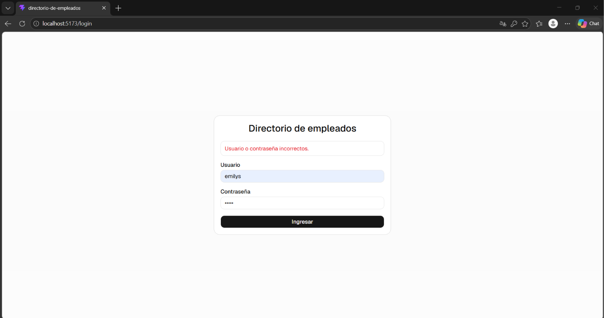
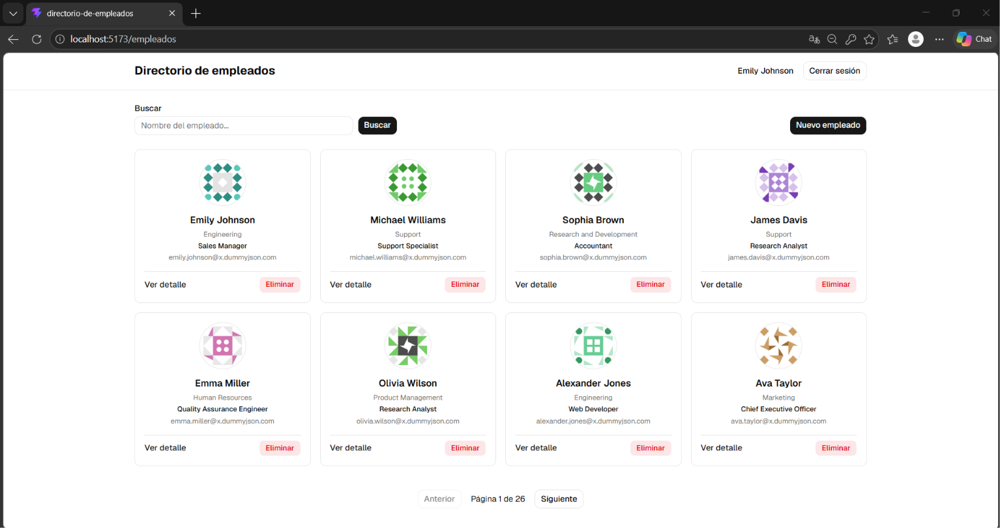
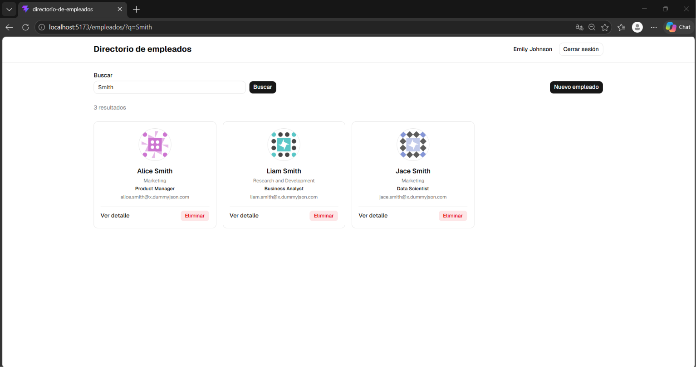
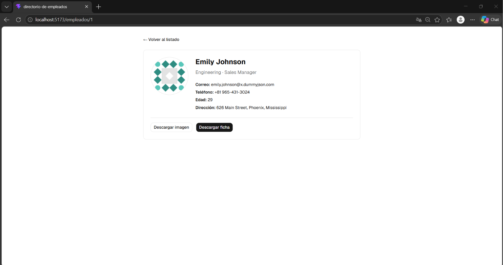
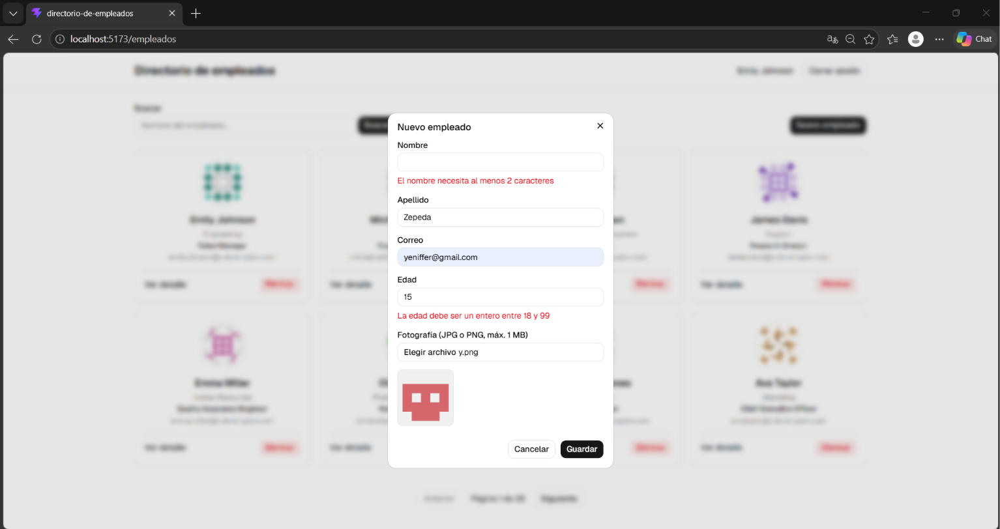
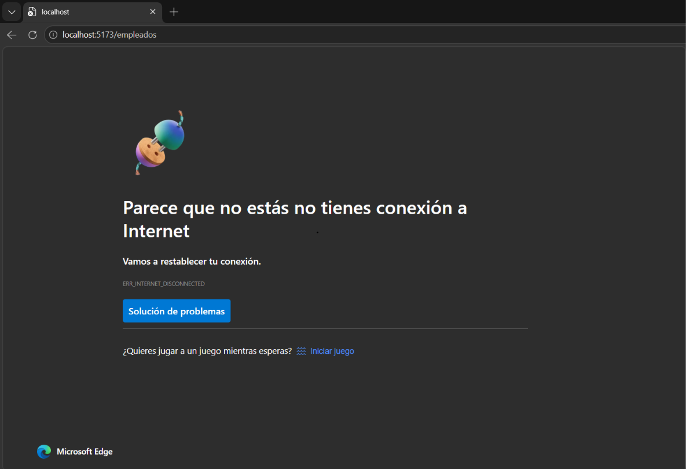

# Directorio de Empleados

Aplicación web SPA desarrollada con **React 19, TypeScript y Vite** para la consulta, búsqueda, creación y gestión de empleados conectada a la API pública **DummyJSON**

🔗 **Aplicación desplegada en Vercel:** https://directorio-de-empleados.vercel.app

---

## Credenciales de prueba

Para iniciar sesión en la aplicación utiliza la cuenta de prueba proporcionada por DummyJSON

* **Usuario:** `emilys`
* **Contraseña:** `emilyspass`

---

## Tecnologías utilizadas

* **Core:** React 19, TypeScript, Vite
* **Enrutamiento:** React Router DOM (`useSearchParams`, rutas protegidas y página 404)
* **Estado del servidor y caché:** TanStack Query (`keepPreviousData`, mutaciones e invalidación de caché)
* **Estado global:** Zustand con middleware `persist` en `localStorage` (`auth-storage`)
* **Cliente HTTP:** Axios con interceptores JWT (inyección automática de `Bearer Token` y renovación de sesión ante errores `401`)
* **Formularios y validación:** React Hook Form, Zod y File API nativa
* **Estilos e interfaz:** Tailwind CSS, shadcn/ui y `react-hot-toast`

---

## Requisitos previos e instalación local

1. **Clonar el repositorio:**
   git clone https://github.com/yzepedar/directorio-de-empleados.git
   cd directorio-de-empleados
  

2. **Instalar dependencias:**
   npm install

3. **Configurar variables de entorno:**
   Crea un archivo `.env.local` en la raíz del proyecto a partir de `.env.example`
   VITE_API_URL=[https://dummyjson.com]

4. **Ejecutar el servidor de desarrollo:**
   npm run dev
   La aplicación estará disponible en `http://localhost:5173`.

---

## Estructura del proyecto

src/
├── components/
│   ├── ui/                     # Componentes base de shadcn/ui
│   ├── CreateEmployeeModal.tsx # Modal con validación Zod y vista previa de fotografía
│   └── ProtectedRoute.tsx      # Guardia de rutas privadas
├── hooks/
│   └── useEmployees.ts         # Hooks de TanStack Query (listado, detalle, creación y eliminación)
├── pages/
│   ├── LoginPage.tsx           # Inicio de sesión con validación y manejo de error 400
│   ├── EmployeesPage.tsx       # Directorio paginado (8 por página) y búsqueda en URL
│   ├── EmployeeDetailPage.tsx  # Ficha del empleado, descarga de imagen (.png) y ficha (.txt)
│   └── NotFoundPage.tsx        # Página 404 con enlace de regreso
├── services/
│   └── api.ts                  # Cliente Axios, interceptores JWT y consumo de endpoints
├── store/
│   └── authStore.ts            # Store de sesión con Zustand (persist)
├── types/
│   └── employee.ts             # Interfaces estrictas de TypeScript
└── utils/
    └── errors.ts               # Función única getErrorMessage para mensajes HTTP y de red
```[cite: 2]

---

## Capturas de funcionamiento

### 1. Inicio de sesión con credenciales incorrectas


### 2. Directorio paginado de empleados


### 3. Búsqueda con resultados en la URL


### 4. Detalle del empleado y descargas


### 5. Modal de creación con validación de formulario/archivo


### 6. Manejo de error de red con botón Reintentar


---

## Consideraciones sobre la API (DummyJSON)

* **Operaciones simuladas:** DummyJSON simula las peticiones `POST /users/add` y `DELETE /users/{id}` devolviendo respuestas exitosas sin persistir cambios en su base de datos remota. Los cambios se reflejan de forma inmediata en la caché local de TanStack Query durante la sesión
* **Despliegue SPA:** Se incluye `vercel.json` para reescribir todas las rutas hacia `/index.html` y evitar errores `404` al recargar vistas internas.